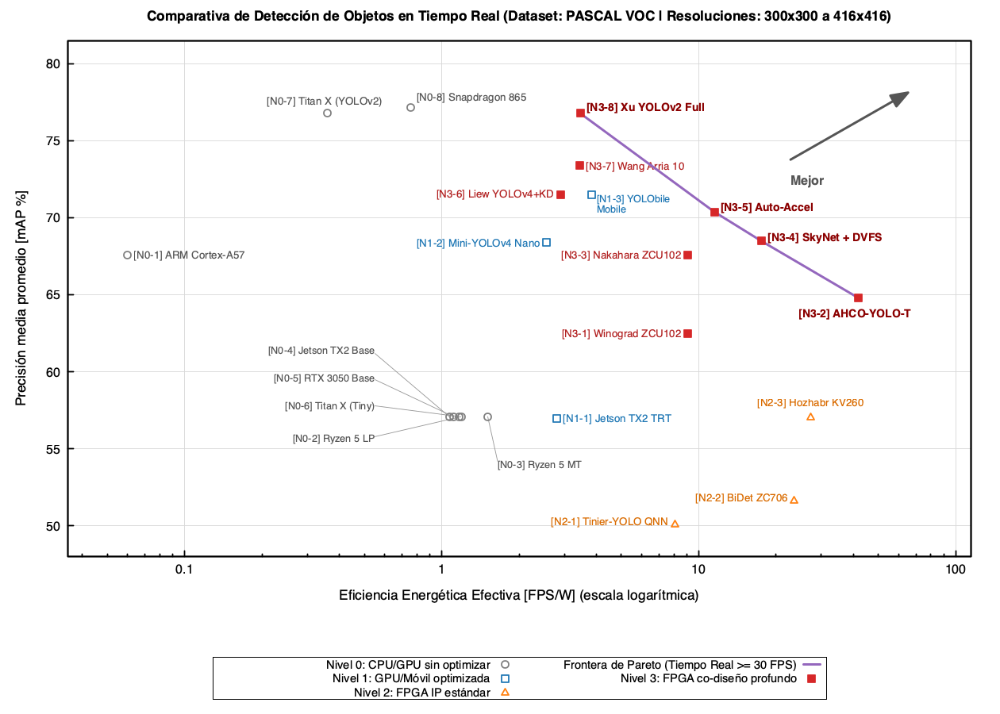

# Material Suplementario: Comparativa de Sistemas de Detección de Objetos en Tiempo Real (CPU, GPU y FPGA)

Este repositorio contiene los datos detallados, la gráfica completa del **Frente de Pareto** y las referencias bibliográficas del póster académico:

> **"Importancia de la Optimización de Modelos de IA para Reconocimiento en Imágenes"**  
> *Edwars Sayeth Rodríguez Martínez, Arturo Méndez Patiño, Juan Carlos Olivares Rojas, Adrián Núñez Vieyra, Enrique Reyes Archundia*  
> Maestría en Ciencias en Ingeniería Electrónica — **Instituto Tecnológico de Morelia (TecNM)**.

---

## 1. Criterios de Comparación y Métricas

Para garantizar una evaluación justa entre arquitecturas convencionales y aceleradores en hardware reconfigurable, los $N = 22$ trabajos incluidos cumplen las siguientes condiciones experimentales:

* **Arquitectura de IA:** Detectores convolucionales de una sola etapa (*one-stage detectors*, familias **YOLO** y **SSD**).
* **Dataset de Evaluación:** Todas las métricas de precisión fueron medidas sobre el *benchmark* estándar **PASCAL VOC** (20 clases, $\text{IoU} > 0.5$) con resoluciones de entrada de $300 \times 300$ a $416 \times 416$ píxeles.
* **Cálculo de Eficiencia Energética Efectiva ($\text{FPS/W}$):** Se obtiene dividiendo la velocidad de inferencia reportada ($\text{FPS}$) entre el consumo total de potencia eléctrica de la plataforma ($\text{W}$).
* **Niveles de Optimización:**
  * **Nivel 0 (`N0`):** Ejecución nativa en punto flotante (`FP32`) sobre CPU o GPU sin compresión.
  * **Nivel 1 (`N1`):** Optimización por compilador/software en GPU embebida o móvil (*TensorRT FP16*, poda por bloques).
  * **Nivel 2 (`N2`):** Despliegue en FPGA mediante núcleos IP estándar (*Vitis AI DPU* o *QNN/FINN*) con cuantificación uniforme (`INT8` o `BNN`).
  * **Nivel 3 (`N3`):** Co-diseño profundo algoritmo-hardware en FPGA (HW-NAS, cuantificación mixta/dinámica, arreglos sistólicos, Winograd, fusión de capas y *pipelining*).

---

## 2. Gráfica del Frente de Pareto ($N = 22$ Sistemas Etiquetados)

*La línea morada conecta los cuatro sistemas no dominados que cumplen tiempo real estricto ($\ge 30\text{ FPS}$) y conforman la **Frontera de Pareto** (`[N3-2]`, `[N3-4]`, `[N3-5]` y `[N3-8]`).*

---

## 3. Tabla Comparativa Detallada de Especificaciones ($N = 22$)

| ID | Sistema / Autor | Modelo de IA (Resolución) | Sistema Computacional / Hardware | Dataset | Precisión (mAP) | Velocidad (FPS) | Consumo (W) | Eficiencia (FPS/W) | Nivel y Optimizaciones Aplicadas | Ref. |
| :--- | :--- | :--- | :--- | :---: | :---: | :---: | :---: | :---: | :--- | :---: |
| **`N0-1`** | ARM Cortex-A57 Base | Lightweight YOLOv2 ($416\times 416$) | CPU ARM Cortex-A57 (Embebido) | PASCAL VOC 07 | 67.60% | 0.23 | 3.8 W | 0.06 | **N0:** Sin optimizar (FP32 secuencial) | [2] |
| **`N0-2`** | Ryzen 5 (Bajo consumo) | Tiny-YOLOv2 ($416\times 416$) | CPU AMD Ryzen 5 5600H (LP) | PASCAL VOC 07 | 57.10% | 2.50 | 2.1 W | 1.19 | **N0:** Sin optimizar (FP32) | [3] |
| **`N0-3`** | Ryzen 5 (Multihilo) | Tiny-YOLOv2 ($416\times 416$) | CPU AMD Ryzen 5 5600H (MT) | PASCAL VOC 07 | 57.10% | 8.00 | 5.3 W | 1.51 | **N0:** Sin optimizar (FP32 multihilo) | [3] |
| **`N0-4`** | Jetson TX2 Base | Tiny-YOLOv2 ($416\times 416$) | GPU NVIDIA Jetson TX2 | PASCAL VOC 07 | 57.10% | 8.00 | 7.5 W | 1.07 | **N0:** Darknet CUDA FP32 sin TensorRT | [1] |
| **`N0-5`** | RTX 3050 Base | Tiny-YOLOv2 ($416\times 416$) | GPU NVIDIA GeForce RTX 3050 | PASCAL VOC 07 | 57.10% | 15.00 | 13.5 W | 1.11 | **N0:** Ejecución SIMT estándar FP32 | [3] |
| **`N0-6`** | Titan X (Tiny) | Tiny-YOLOv2 ($416\times 416$) | GPU NVIDIA GTX Titan X (12 GB) | PASCAL VOC 07 | 57.10% | **207.00** | 177.0 W | 1.17 | **N0:** Darknet FP32 en escritorio | [4] |
| **`N0-7`** | Titan X (YOLOv2) | YOLOv2 Completo ($416\times 416$) | GPU NVIDIA GTX Titan X (12 GB) | PASCAL VOC 07 | 76.80% | 67.00 | 185.0 W | 0.36 | **N0:** Darknet FP32 en escritorio | [4] |
| **`N0-8`** | Snapdragon 865 Base | YOLOv4 Completo ($416\times 416$) | SoC Móvil Qualcomm Snapdragon 865 | PASCAL VOC 07 | **77.20%** | 3.80 | 5.0 W | 0.76 | **N0:** FP32 móvil sin comprimir | [5] |
| **`N1-1`** | Jetson TX2 TRT | Tiny-YOLOv2 ($416\times 416$) | GPU NVIDIA Jetson TX2 (Max-P) | PASCAL VOC 07 | 57.00% | 29.50 | 10.5 W | 2.81 | **N1:** Cuantificación FP16 + Fusión TensorRT | [1] |
| **`N1-2`** | Mini-YOLOv4 Nano | Mini-YOLOv4 ($416\times 416$) | GPU NVIDIA Jetson Nano | PASCAL VOC 07 | 68.40% | 25.60 | 10.0 W | 2.56 | **N1:** Cuantificación FP16 + Pirámide ligera | [1] |
| **`N1-3`** | YOLObile Mobile | YOLOv4 Comprimido ($320\times 320$) | GPU+CPU Qualcomm Snapdragon 865 | PASCAL VOC 07 | 71.50% | 19.10 | 5.0 W | 3.82 | **N1:** Poda por bloques + Co-ejecución GPU-CPU | [5] |
| **`N2-1`** | Tinier-YOLO QNN | Tinier-YOLO ($416\times 416$) | FPGA MPSoC Avnet Ultra96-V2 | PASCAL VOC 07 | 50.10% | 25.00 | 3.1 W | 8.06 | **N2:** Cuantificación 1b/3b (QNN) + BRAM | [1, 13] |
| **`N2-2`** | BiDet ZC706 | YOLO Binarizado ($320\times 320$) | FPGA Xilinx Zynq ZC706 | PASCAL VOC 07 | 51.68% | 66.00 | 2.8 W | 23.57 | **N2:** Poda + BNN 1-bit (XNOR) + BRAM | [1, 6] |
| **`N2-3`** | Hozhabr KV260 | Tiny-YOLOv2 ($416\times 416$) | FPGA MPSoC AMD Kria KV260 (DPU) | PASCAL VOC 07 | 57.10% | 30.00 | **1.1 W** | 27.27 | **N2:** Cuantificación INT8 + BRAM + AXI Pipe | [3] |
| **`N3-1`** | Winograd ZCU102 | Tiny-YOLOv3 ($416\times 416$) | FPGA Xilinx ZCU102 / Kintex-7 | PASCAL VOC 07 | 62.50% | 65.20 | 7.2 W | 9.06 | **N3:** INT8 + Winograd $F(2,3)$ + Arreglo sistólico | [1, 7] |
| **`N3-2`** | **AHCO-YOLO-T** | **AHCO-YOLO-T ($320\times 320$)** | **FPGA MPSoC Xilinx ZCU104** | **PASCAL VOC 07** | **64.80%** | **79.80** | 1.9 W | **41.90** | **N3 (Pareto #1):** HW-NAS + Cuant. 4b/8b + Dataflow IS/WS | [8] |
| **`N3-3`** | Nakahara ZCU102 | Lightweight YOLOv2 ($416\times 416$) | FPGA MPSoC Xilinx ZCU102 | PASCAL VOC 07 | 67.60% | 40.81 | 4.5 W | 9.07 | **N3:** BNN + SVR paralelo + BRAM + Streaming Pipe | [2] |
| **`N3-4`** | **SkyNet + DVFS** | **SkyNet Detector ($320\times 320$)** | **FPGA MPSoC Avnet Ultra96-V2** | **PASCAL VOC 07** | **68.50%** | 38.60 | 2.2 W | **17.55** | **N3 (Pareto #2):** HW-NAS + INT8 + DVFS dinámico + Ping-pong | [1, 9] |
| **`N3-5`** | **Auto-Accel** | **SSDLite-MobileNetV2 ($300\times 300$)** | **FPGA MPSoC Xilinx ZCU102** | **PASCAL VOC 07** | **70.40%** | 57.50 | 5.0 W | **11.50** | **N3 (Pareto #3):** DW-Conv + Cuant. 8b + Loop tiling + Pipe | [1, 10] |
| **`N3-6`** | Liew YOLOv4+KD | YOLOv4 Comprimido ($416\times 416$) | FPGA MPSoC Xilinx ZCU102 | PASCAL VOC 07 | 71.50% | 33.34 | 11.5 W | 2.90 | **N3:** Poda (-56%) + INT8 (-88%) + Destilación KD | [1, 14] |
| **`N3-7`** | Wang Arria 10 | YOLOv2 Podado ($416\times 416$) | FPGA Intel Arria 10 GX 1150 | PASCAL VOC 07 | 73.40% | 61.90 | 18.0 W | 3.44 | **N3:** Poda (-7$\times$) guiada por Roofline + Fusión + Sistólico | [1, 11] |
| **`N3-8`** | **Xu YOLOv2 Full** | **YOLOv2 Completo ($416\times 416$)** | **FPGA Xilinx ZCU102 / Virtex-7** | **PASCAL VOC 07** | **76.80%** | 71.00 | 20.5 W | **3.46** | **N3 (Pareto #4):** Arreglo sistólico 2D + Fusión Conv+BN+Act | [1, 12] |

---

## 4. Referencias Bibliográficas

1. S. H. Hozhabr and R. Giorgi, *"A Survey on Real-Time Object Detection on FPGAs,"* **IEEE Access**, vol. 13, pp. 38195–38238, 2025. DOI: `10.1109/ACCESS.2025.3544515`.
2. H. Nakahara, H. Yonekawa, T. Fujii, and S. Sato, *"A Lightweight YOLOv2: A Binarized CNN with A Parallel Support Vector Regression for an FPGA,"* in **Proc. ACM/SIGDA Int. Symp. Field-Programmable Gate Arrays (FPGA)**, 2018, pp. 31–40.
3. S. H. Hozhabr, *"From Real-Time Object Detection to Graph Convolutional Networks: Efficient Deep Learning Acceleration on FPGAs,"* Ph.D. dissertation, Dept. Inf. Eng. Math., **University of Siena**, Italy, 2025.
4. J. Redmon and A. Farhadi, *"YOLO9000: Better, Faster, Stronger,"* in **Proc. IEEE Conf. Comput. Vis. Pattern Recognit. (CVPR)**, 2017, pp. 7263–7271.
5. Y. Cai et al., *"YOLObile: Real-Time Object Detection on Mobile Devices via Compression-Compilation Co-Design,"* in **Proc. AAAI Conf. Artif. Intell.**, vol. 35, no. 2, pp. 955–963, 2021.
6. J. Zhang et al., *"BiDet: An Efficient Binarized Object Detector,"* in **Proc. IEEE/CVF Conf. Comput. Vis. Pattern Recognit. (CVPR)**, 2020 (implementación FPGA compilada en [1]).
7. R. Cai et al. / C. Bao et al., *"Winograd-based Real-Time Object Detection Accelerators on FPGA,"* compilado en **IEEE Access**, vol. 13, 2025 [1].
8. J. Kim, J.-K. Kang, and Y. Kim, *"AHCO-YOLO: An Algorithm–Hardware Co-Optimization Framework for Energy-Efficient and Real-Time Object Detection on Edge Devices,"* **IEEE Trans. Very Large Scale Integr. (VLSI) Syst.**, vol. 34, no. 2, pp. 402–415, Feb. 2026.
9. X. Zhang et al., *"SkyNet: A Hardware-Efficient Method for Object Detection and Tracking on Embedded Systems,"* in **Proc. Mach. Learn. Syst. (MLSys)**, 2020 (con extensión DVFS compilada en [1]).
10. C. Hao et al., *"FPGA/DNN Co-Design: An Efficient Design Methodology for IoT Intelligence on the Edge,"* in **Proc. 56th ACM/IEEE Design Autom. Conf. (DAC)**, 2019 (Auto-Accel SSDLite, compilado en [1]).
11. W. Wang et al., *"Roofline-Guided Pruning and FPGA Acceleration for YOLOv2 on Intel Arria 10,"* compilado en **IEEE Access**, vol. 13, Tables 9–10, 2025 [1].
12. K. Xu, X. Wang, X. Liu, and D. Wang, *"A Dedicated Hardware Accelerator for Real-Time Acceleration of YOLOv2,"* **J. Real-Time Image Process.**, vol. 18, pp. 481–492, 2021.
13. R. Franco et al., *"Tinier-YOLO: Ultra-Low-Precision Object Detection on Embedded FPGAs,"* compilado en **IEEE Access**, vol. 13, 2025 [1].
14. K. Liew et al., *"Pruning, Quantization, and Knowledge Distillation for YOLOv4 on Zynq UltraScale+ MPSoC,"* compilado en **IEEE Access**, vol. 13, 2025 [1].