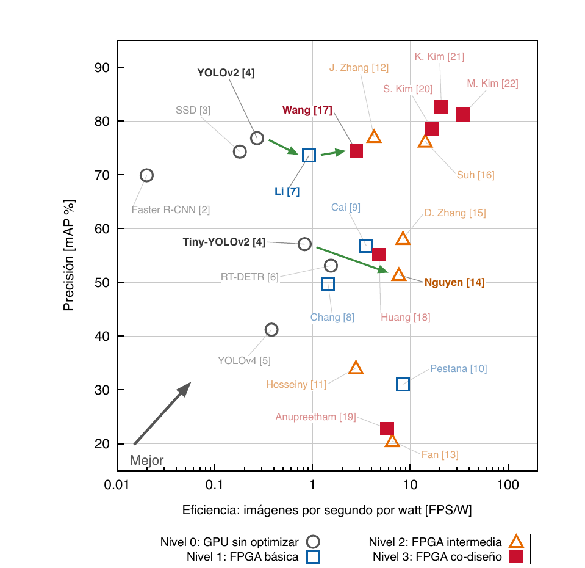

# Material Suplementario: Comparativa de Detección de Objetos en Tiempo Real (GPU vs. FPGA)

Anexo técnico y reproducible del póster académico:

> **"Importancia de la Optimización de Modelos de IA para Reconocimiento en Imágenes"**  
> *Edwars Sayeth Rodríguez Martínez, Arturo Méndez Patiño, Juan Carlos Olivares Rojas, Adrián Núñez Vieyra, Enrique Reyes Archundia*  
> Maestría en Ciencias de la Ingeniería Electrónica — **Instituto Tecnológico de Morelia (TecNM)**.

---

## 1. Metodología de Selección y Condiciones Experimentales

Todos los datos cuantitativos provienen de las tablas comparativas sistematizadas por **Hozhabr y Giorgi (2025)** [1]:

1. **Criterio de Inclusión Arquitectónica:** Se seleccionaron detectores convolucionales de una sola etapa (*DNN One-stage Detectors*, familias **YOLO** y **SSD**) de las Tablas 2, 9 y 10 [1], junto con referencias representativas de dos etapas y Transformers en GPU como contexto de línea base.
2. **Criterio de Completitud de Datos:** De las 19 implementaciones FPGA compiladas en las Tablas 9 y 10, se excluyeron 3 estudios que omiten el consumo de potencia (`Jain et al. [77]`, `Xu et al. [76]`) o la precisión (`Babu et al. [90]`) —números de referencia de [1], ya que no forman parte de este conjunto—, conservando los **$16$ aceleradores FPGA** con registros completos de `(mAP %, FPS, Potencia W)`.
3. **Líneas Base en GPU Sin Optimizar (Nivel 0):** Se incluyeron **$6$ implementaciones nativas en FP32** reportadas en la Tabla 2 (`NVIDIA GTX Titan X`, `Tesla V100`, `Tesla K40` y `Tesla T4`).
4. **Cálculo de Métricas Normalizadas:**
   * **Eficiencia Energética Efectiva ($\text{FPS/W}$):** Cociente entre la tasa de cuadros ($\text{FPS}$) y la potencia eléctrica ($\text{W}$). Para las plataformas FPGA se utiliza la potencia reportada en la Tabla 9 (en general medida en placa; ver excepciones en *Limitaciones*); para las GPUs de la Tabla 2 (sin medición de potencia en texto) se normaliza de forma estándar mediante su TDP nominal ($250\text{ W}$ para Titan X / V100, $235\text{ W}$ para K40 y $70\text{ W}$ para T4).
   * **Rendimiento Espacial (*Pixel Throughput*, $\text{MPPS}$):** $\text{FPS} \times \text{Píxeles por fotograma}$, incorporado para normalizar diferencias de resolución de entrada ($192\times 256$ a $1280\times 384$).
5. **Criterio de Asignación de Niveles de Optimización:**
   * **Nivel 0 — GPU sin optimizar:** inferencia nativa en FP32 sobre GPU, sin compresión ni hardware dedicado.
   * **Nivel 1 — FPGA optimización básica:** el diseño se apoya principalmente en una sola técnica (p. ej., cuantización de precisión mixta, cuantización post-entrenamiento o convolución Winograd).
   * **Nivel 2 — FPGA optimización intermedia:** combina compresión del modelo (cuantización, poda o pesos binarios) con optimizaciones de memoria o de flujo de datos (reuso de datos, *loop tiling*, *pipelining*, compartición de recursos).
   * **Nivel 3 — FPGA co-diseño profundo:** el modelo y el acelerador se diseñan en conjunto (co-diseño algoritmo-hardware, poda guiada por *Roofline*, simplificación del modelo para el hardware), según las técnicas clave reportadas en la Tabla 10 [1].

### Limitaciones y Notas de Interpretación

* **Conjuntos de datos distintos:** la Tabla 9 de [1] no reporta el conjunto de datos de cada implementación FPGA. La mAP mostrada es la reportada por cada autor, y no todos usan el mismo *benchmark* (las GPUs de la Tabla 2 se evalúan en PASCAL VOC o MS COCO). Por ello, el eje de precisión debe leerse como **indicativo** y no como una comparación directa entre sistemas.
* **Potencia en GPU:** para las GPUs se usa el TDP nominal, que es una **cota superior** del consumo real; para las FPGAs se usa la potencia medida en placa reportada en [1]. La ganancia GPU → FPGA puede estar sobreestimada.
* **Comparación justa del mismo modelo:** el par más homogéneo del conjunto es YOLOv2 ($416\times 416$) en Titan X [4] frente a Sparse-YOLO en Arria-10 [17]: $0.27 \rightarrow 2.79$ FPS/W ($\approx 10\times$) con una pérdida de $2.35$ puntos de mAP ($76.80\% \rightarrow 74.45\%$; $2.3$ puntos con los valores redondeados de la tabla del póster, $76.8\% \rightarrow 74.5\%$). Es el ejemplo que se usa en el bloque "¿Sabías que...?" del póster.
* **MPPS de K. Kim [21] y M. Kim [22]:** los valores de MPPS (4.14 y 4.50) se transcriben tal como aparecen en la Tabla 9 de [1], aunque no coinciden con $\text{FPS} \times \text{resolución}$ ($2.16$ y $7.86$ MPPS, respectivamente). No afectan la gráfica, que usa FPS/W.
* **Suh et al. [16] (dataset propio):** el valor de $76.20\%$ mAP, $34.18$ FPS y $2.4$ W corresponde al modelo VGG16-SSD reducido a $0.25\times$ evaluado sobre un **conjunto de datos propio de drones** (Tabla 9 del artículo original), no sobre PASCAL VOC; el artículo solo reporta VOC en software para el modelo completo ($1.0\times$, $77.2\%$). Por ello no se usa como ejemplo representativo en el póster: para el Nivel 2 se usa Nguyen et al. [14] (Tiny-YOLOv2, reentrenado y cuantizado en PASCAL VOC), comparable con la línea base Tiny-YOLOv2 en Titan X [4].
* **Conjuntos de datos no estándar:** al revisar los artículos originales, Suh et al. [16] (dataset propio de drones) y Cai et al. [9] (dataset submarino RUIE) no usan PASCAL VOC ni MS COCO. Además, la mAP de M. Kim [22], K. Kim [21], S. Kim [20] y J. Zhang [12] es superior a la que su modelo alcanza en VOC/COCO, por lo que muy probablemente usan conjuntos propios o de un dominio específico. Por eso la gráfica **no señala un "mejor" sistema global**: los puntos más altos pueden deberse a un conjunto de datos más sencillo y no al diseño. La comparación directa se limita a los sistemas resaltados en la gráfica, que comparten modelo, resolución ($416\times 416$) y dataset (PASCAL VOC): YOLOv2 en Titan X [4] vs. Li et al. [7] y Sparse-YOLO [17], y Tiny-YOLOv2 en Titan X [4] vs. Nguyen et al. [14].
* **Potencia de Li et al. [7]:** se usa el valor de $27.2$ W reportado en la Tabla 9 de [1]. El resumen del artículo original menciona $12.2$ W de potencia de *kernel* (solo la lógica del acelerador OpenCL, sin el resto de la placa); se conserva el valor del survey por consistencia con la fuente. Li et al. [7], Nguyen et al. [14] y Sparse-YOLO [17] se verificaron en sus artículos originales como evaluados en PASCAL VOC.
* **Discrepancias del survey con los artículos originales:** el artículo de Anupreetham et al. [19] reporta 2,167 FPS (con 2.13 ms de latencia), no los 469 FPS de la Tabla 9 de [1]; y CoDeNet (Huang et al. [18]) reporta 61.7% AP50 en PASCAL VOC a 26.9 FPS, no 55.1%. Se conservan los valores de [1] por consistencia con la fuente.
* **Verificación de conjuntos de datos (columna *Dataset*):** Anupreetham et al. [19] reportan sus resultados sobre el conjunto de validación de COCO, y su potencia (81 W) es una **estimación** con el análisis *vectorless* de Quartus, no una medición en placa. K. Kim et al. [21] evalúan su modelo sobre un conjunto con 13,041 objetos anotados, que no corresponde a PASCAL VOC ni a COCO. Hosseiny et al. [11] citan COCO como referencia de entrenamiento, pero no se pudo confirmar en el texto completo. Chang [8], J. Zhang [12], D. Zhang [15], S. Kim [20] y M. Kim [22] no están en acceso abierto y su conjunto de datos queda **sin verificar**; de J. Zhang [12] solo se confirmó la entrada de $1280\times 384$.
* **Diferencias con la Tabla 2 de [1]:** para RT-DETR [6], la Tabla 2 indica una entrada de $1024\times 1024$, pero el artículo original evalúa a $640\times 640$, que es la resolución que se reporta aquí (los valores de mAP y FPS coinciden con la Tabla 2). Para SSD [3], la fila de la Tabla 2 indica ResNet-101 como *backbone*, mientras que el texto de [1] y el artículo original usan VGG-16 (SSD300), que es el que se reporta aquí.
* **Exclusión de Xu et al. (ref. [76] de [1]):** su acelerador en Arria-10 reporta YOLOv2 a $288\times 288$ (35 FPS) y Tiny-YOLOv2 a $416\times 416$ (71 FPS), pero [1] no reporta su potencia, por lo que no se incluye.

---

## 2. Gráfica Comparativa ($N = 22$ sistemas)

Es la misma figura del póster (Figura 1) y se genera con el mismo script, pero aquí cada etiqueta lleva el número de la referencia original en la Sección 4 de este README. Cada punto es un sistema: más a la derecha, más imágenes por watt; más arriba, más preciso. **La etiqueta de cada punto es idéntica a la columna *Etiqueta en la gráfica* de la Sección 3** y a la última columna de `data/sistemas.dat`.

**Comparaciones justas:** los sistemas en **negritas**, unidos por **flechas verdes**, comparten modelo, resolución ($416\times 416$) y conjunto de datos (PASCAL VOC), por lo que su precisión sí se puede comparar directamente. Cada flecha va de la GPU sin optimizar a las FPGAs del mismo modelo:

| Modelo | GPU (N0) | FPGA | FPS/W | Ganancia | Cambio en mAP |
| :--- | :--- | :--- | :---: | :---: | :---: |
| YOLOv2 | `YOLOv2 [4]` (Titan X): 0.27 FPS/W | `Li [7]` (N1, Arria 10) | 0.92 | $3.4\times$ | $-3.2$ pts |
| YOLOv2 | `YOLOv2 [4]` (Titan X): 0.27 FPS/W | `Wang [17]` (N3, Sparse-YOLO, Arria 10) | 2.79 | $10.4\times$ | $-2.35$ pts |
| Tiny-YOLOv2 | `Tiny-YOLOv2 [4]` (Titan X): 0.83 FPS/W | `Nguyen [14]` (N2, VC707) | 7.65 | $9.2\times$ | $-5.7$ pts |

Es la misma comparación de la tabla del póster.

> En el póster, las etiquetas indican solo de dónde se tomaron los datos: [6] corresponde al survey de Hozhabr y Giorgi (ref. 1 de este README), [11] a Redmon y Farhadi (ref. 4) y [12] a Sparse-YOLO (ref. 17).

---

## 3. Tabla Comparativa Detallada de Especificaciones ($N = 22$)

> **Nota de trazabilidad:** cada fila se puede seguir en ambos sentidos: **gráfica** (columna *Etiqueta en la gráfica*, idéntica a la etiqueta del punto) → **survey** (columna *Fuente en [1]*: tabla de [1] y número de referencia interno del survey para ubicar la fila) → **trabajo original** (número entre corchetes de la etiqueta, Sección 4). En la columna **Dataset**, ✓ indica que se verificó en el artículo original.

### A. Nivel 0 — Líneas Base en GPU Sin Optimizar (FP32)

| Etiqueta en la gráfica | Fuente en [1] | Modelo de IA (Backbone) | Plataforma GPU | Dataset | Resolución | Precisión (mAP) | Velocidad (FPS) | TDP Nominal (W) | Eficiencia (FPS/W) |
| :--- | :--- | :--- | :--- | :---: | :---: | :---: | :---: | :---: | :---: |
| **`Faster R-CNN [2]`** | Tabla 2, ref. [22] | Faster R-CNN (VGG-16, 2 etapas) | NVIDIA Tesla K40 | PASCAL VOC | $1000\times 600$ | 69.90% | 5.00 | 235.0 W | 0.02 |
| **`SSD [3]`** | Tabla 2, ref. [19] | SSD300 (VGG-16) | NVIDIA Titan X | PASCAL VOC | $300\times 300$ | 74.30% | 46.00 | 250.0 W | 0.18 |
| **`YOLOv2 [4]`** | Tabla 2, ref. [71] | YOLOv2 (DarkNet-19) | NVIDIA GTX Titan X | PASCAL VOC | $416\times 416$ | 76.80% | 67.00 | 250.0 W | 0.27 |
| **`YOLOv4 [5]`** | Tabla 2, ref. [23] | YOLOv4 (CSPDarknet-53) | NVIDIA Tesla V100 | MS COCO | $416\times 416$ | 41.20% | 96.00 | 250.0 W | 0.38 |
| **`Tiny-YOLOv2 [4]`** | Tabla 2, ref. [71] | Tiny-YOLOv2 (DarkNet-19) | NVIDIA GTX Titan X | PASCAL VOC | $416\times 416$ | 57.10% | 207.00 | 250.0 W | 0.83 |
| **`RT-DETR [6]`** | Tabla 2, ref. [13] | RT-DETR (ResNet-50, Transformer) | NVIDIA Tesla T4 | MS COCO | $640\times 640$ | 53.10% | 108.00 | 70.0 W | 1.54 |

### B. Niveles 1 a 3 — Implementaciones Optimizadas en FPGA

| Etiqueta en la gráfica | Fuente en [1] | Nivel | Modelo de IA | Precisión (W, A) | Plataforma FPGA (Freq.) | Resolución | Dataset | mAP (%) | FPS | MPPS | Potencia (W) | FPS/W | GOPS/W | Técnicas Clave Empleadas |
| :--- | :--- | :---: | :--- | :---: | :--- | :---: | :---: | :---: | :---: | :---: | :---: | :---: | :---: | :--- |
| **`Li [7]`** | Tablas 9–10, ref. [74] | N1 | YOLOv2 | (8, N/A) | Intel Arria 10 (200 MHz) | $416\times 416$ | PASCAL VOC ✓ | 73.60% | 25.00 | 4.32 | 27.20 W | 0.92 | 27.20 | Datos de precisión mixta, diseño paralelo, *pipelining* |
| **`Chang [8]`** | Tablas 9–10, ref. [82] | N1 | YOLOv3 | (2-8, 2-8) | Xilinx ZCU102 (200 MHz) | $640\times 480$ | No verificado | 49.70% | 22.00 | 6.75 | 15.30 W | 1.44 | 52.87 | Cuantificación de precisión mixta |
| **`Cai [9]`** | Tablas 9–10, ref. [68] | N1 | SSDLite-MobileNetV3 | (16, N/A) | Xilinx XC7Z045 (150 MHz) | $300\times 300$ | RUIE (submarino) ✓ | 56.80% | 33.14 | 2.98 | 9.34 W | 3.55 | N/A | Winograd + optimización de memoria (*ping-pong*) |
| **`Pestana [10]`** | Tablas 9–10, ref. [85] | N1 | Tiny-YOLOv3 | (16, 16) | Xilinx XCKU040 (143 MHz) | $768\times 576$ | MS COCO (probable) | 31.00% | 32.40 | 14.33 | 3.87 W | 8.37 | 46.51 | Cuantificación dinámica post-entrenamiento (PTQ) |
| **`Hosseiny [11]`** | Tablas 9–10, ref. [92] | N2 | Tiny-YOLOv7 | (13, 13) | Xilinx XC7Z100 (100 MHz) | $640\times 640$ | MS COCO (probable) | 34.10% | 30.00 | 12.28 | 10.79 W | 2.78 | N/A | Modificación de código, *pipelining*, reuso de datos |
| **`J. Zhang [12]`** | Tablas 9–10, ref. [48] | N2 | Tiny-YOLOv2 | (8, 8) | Xilinx ZC706 (200 MHz) | $1280\times 384$ | No verificado (resolución típica de KITTI) | 77.04% | 43.70 | 21.47 | 10.25 W | 4.26 | 45.30 | Compartición de recursos, *pipelining*, opt. aritmética |
| **`Fan [13]`** | Tablas 9–10, ref. [47] | N2 | SSDLite-MobileNetV2 | (8, 8) | Xilinx ZC706 (100 MHz) | $224\times 224$ | MS COCO ✓ | 20.50% | 64.80 | 3.25 | 9.90 W | 6.55 | N/A | Cuantificación parcial, compartición, poda de canales |
| **`Nguyen [14]`** | Tablas 9–10, ref. [15] | N2 | Tiny-YOLOv2 | (1, 6) | Xilinx VC707 (200 MHz) | $416\times 416$ | PASCAL VOC ✓ | 51.38% | 66.56 | 11.51 | 8.70 W | 7.65 | 53.29 | Pesos binarios, cuantificación QAT, reuso de datos |
| **`D. Zhang [15]`** | Tablas 9–10, ref. [86] | N2 | Tiny-YOLOv3 | (8, 8) | Xilinx XC7K325T (200 MHz) | $416\times 416$ | No verificado | 58.10% | 65.70 | 11.36 | 7.80 W | 8.42 | 51.40 | Reuso en búfer *ping-pong*, opt. acceso a memoria |
| **`Suh [16]`** | Tablas 9–10, ref. [69] | N2 | SSD-VGG16 | (8, 8) | Xilinx ZU3EG (200 MHz) | $300\times 300$ | Propio (drones) ✓ | 76.20% | 34.18 | 3.07 | 2.40 W | 14.24 | 57.50 | Cuantificación baja precisión, *loop tiling*, poda |
| **`Wang [17]`** | Tablas 9–10, ref. [73] | N3 | YOLOv2 | N/A | Intel Arria-10 GX1150 (211 MHz) | $416\times 416$ | PASCAL VOC ✓ | 74.45% | 72.50 | 12.54 | 26.00 W | 2.79 | **81.92** | Poda fina (*Roofline*), co-diseño hardware/software |
| **`Huang [18]`** | Tablas 9–10, ref. [193] | N3 | ShuffleNetV2-based | (4, 8) | Xilinx Ultra96 (250 MHz) | $256\times 256$ | PASCAL VOC ✓ | 55.10% | 26.90 | 1.76 | 5.60 W | 4.80 | N/A | Reuso de datos, co-diseño algoritmo-hardware |
| **`Anupreetham [19]`** | Tablas 9–10, ref. [67] | N3 | SSDLite-MobileNetV1 | N/A | Intel Stratix 10 GX2800 (400 MHz) | $640\times 640$ | MS COCO ✓ | 22.80% | **469.00** | **192.00** | 81.00 W | 5.79 | N/A | NMS segmentado (*pipelining*), proc. paralelo |
| **`S. Kim [20]`** | Tablas 9–10, ref. [46] | N3 | SSDLite | (16, 16) | Intel Arria 10 (200 MHz) | $224\times 224$ | No verificado | 78.60% | 84.40 | 4.23 | 5.10 W | 16.55 | N/A | Opt. aritmética y de acceso a memoria, reuso de datos |
| **`K. Kim [21]`** | Tablas 9–10, ref. [191] | N3 | SqueezeNet-based | (8, 8) | Xilinx ZC702 (100 MHz) | $192\times 256$ | No estándar (probable propio) ✓ | 82.60% | 43.95 | 4.14 | 2.11 W | 20.83 | N/A | Simplificación/compresión + proc. paralelo |
| **`M. Kim [22]`** | Tablas 9–10, ref. [84] | N3 | Tiny-YOLOv3 | (8, 8) | Xilinx Artix-7 (100 MHz) | $320\times 320$ | No verificado | 81.19% | 76.75 | 4.50 | 2.20 W | 34.89 | 43.16 | Reuso dinámico + cuantificación hardware |

---

## 4. Referencias Bibliográficas (Exactas de [1])

1. S. H. Hozhabr and R. Giorgi, *"A Survey on Real-Time Object Detection on FPGAs,"* **IEEE Access**, vol. 13, pp. 38195–38238, 2025. DOI: `10.1109/ACCESS.2025.3544515`.
2. S. Ren, K. He, R. Girshick, and J. Sun, *"Faster R-CNN: Towards real-time object detection with region proposal networks,"* in **Proc. Adv. Neural Inf. Process. Syst. (NeurIPS)**, vol. 28, Dec. 2015, pp. 91–99.
3. W. Liu et al., *"SSD: Single shot MultiBox detector,"* in **Proc. 14th Eur. Conf. Comput. Vis. (ECCV)**, Jan. 2016, pp. 21–37.
4. J. Redmon and A. Farhadi, *"YOLO9000: Better, faster, stronger,"* in **Proc. IEEE Conf. Comput. Vis. Pattern Recognit. (CVPR)**, Jul. 2017, pp. 7263–7271.
5. A. Bochkovskiy, C.-Y. Wang, and H.-Y. M. Liao, *"YOLOv4: Optimal speed and accuracy of object detection,"* `arXiv:2004.10934`, 2020.
6. Y. Zhao et al., *"DETRs beat YOLOs on real-time object detection,"* `arXiv:2304.08069`, 2023.
7. S. Li, Y. Luo, K. Sun, N. Yadav, and K. K. Choi, *"A novel FPGA accelerator design for real-time and ultra-low power deep convolutional neural networks compared with Titan X GPU,"* **IEEE Access**, vol. 8, pp. 105455–105471, 2020. doi: 10.1109/ACCESS.2020.3000009.
8. L. Chang, S. Zhang, H. Du, Y. Chen, and S. Wang, *"A reconfigurable neural network processor with tile-grained multicore pipeline for object detection on FPGA,"* **IEEE Trans. Very Large Scale Integr. (VLSI) Syst.**, vol. 29, no. 11, pp. 1967–1980, 2021.
9. L. Cai, C. Wang, and Y. Xu, *"A real-time FPGA accelerator based on Winograd algorithm for underwater object detection,"* **Electronics**, vol. 10, no. 23, p. 2889, Nov. 2021.
10. D. Pestana, P. R. Miranda, J. D. Lopes, R. P. Duarte, M. P. Véstias, H. C. Neto, and J. T. de Sousa, *"A full featured configurable accelerator for object detection with YOLO,"* **IEEE Access**, vol. 9, pp. 75864–75877, 2021.
11. A. Hosseiny and H. Jahanirad, *"Hardware acceleration of YOLOv7-tiny using high-level synthesis tools,"* **J. Real-Time Image Process.**, vol. 20, no. 4, art. no. 75, 2023.
12. J. Zhang, L. Cheng, C. Li, Y. Li, G. He, N. Xu, and Y. Lian, *"A low-latency FPGA implementation for real-time object detection,"* in **Proc. IEEE Int. Symp. Circuits Syst. (ISCAS)**, 2021, pp. 1–5.
13. H. Fan, S. Liu, M. Ferianc, H.-C. Ng, Z. Que, S. Liu, X. Niu, and W. Luk, *"A real-time object detection accelerator with compressed SSDLite on FPGA,"* in **Proc. Int. Conf. Field-Programmable Technology (FPT)**, 2018, pp. 14–21.
14. D. T. Nguyen, T. N. Nguyen, H. Kim, and H.-J. Lee, *"A high-throughput and power-efficient FPGA implementation of YOLO CNN for object detection,"* **IEEE Trans. Very Large Scale Integr. (VLSI) Syst.**, vol. 27, no. 8, pp. 1861–1873, Aug. 2019.
15. D. Zhang, A. Wang, R. Mo, and D. Wang, *"End-to-end acceleration of the YOLO object detection framework on FPGA-only devices,"* **Neural Comput. Appl.**, vol. 36, no. 3, pp. 1067–1089, 2024.
16. H.-S. Suh, J. Meng, T. Nguyen, V. Kumar, Y. Cao, and J.-S. Seo, *"Algorithm-hardware co-optimization for energy-efficient drone detection on resource-constrained FPGA,"* **ACM Trans. Reconfigurable Technol. Syst.**, vol. 16, no. 2, pp. 1–25, Jun. 2023.
17. Z. Wang, K. Xu, S. Wu, L. Liu, L. Liu, and D. Wang, *"Sparse-YOLO: Hardware/software co-design of an FPGA accelerator for YOLOv2,"* **IEEE Access**, vol. 8, pp. 116569–116585, 2020. doi: 10.1109/ACCESS.2020.3004198.
18. Q. Huang et al., *"CoDeNet: Efficient deployment of input-adaptive object detection on embedded FPGAs,"* in **Proc. ACM/SIGDA Int. Symp. Field-Program. Gate Arrays (FPGA)**, Feb. 2021, pp. 206–216.
19. A. Anupreetham et al., *"High throughput FPGA-based object detection via algorithm-hardware codesign,"* **ACM Trans. Reconfigurable Technol. Syst.**, vol. 17, no. 1, pp. 1–20, Mar. 2024.
20. S. Kim, S. Na, B. Y. Kong, J. Choi, and I.-C. Park, *"Real-time SSDLite object detection on FPGA,"* **IEEE Trans. Very Large Scale Integr. (VLSI) Syst.**, vol. 29, no. 6, pp. 1192–1205, 2021.
21. K. Kim, S.-J. Jang, J. Park, E. Lee, and S.-S. Lee, *"Lightweight and energy-efficient deep learning accelerator for real-time object detection on edge devices,"* **Sensors**, vol. 23, no. 3, p. 1185, Jan. 2023.
22. M. Kim, K. Oh, Y. Cho, H. Seo, X. T. Nguyen, and H.-J. Lee, *"A low-latency FPGA accelerator for YOLOv3-tiny with flexible layerwise mapping and dataflow,"* **IEEE Trans. Circuits Syst. I, Reg. Papers**, vol. 71, no. 3, pp. 1158–1171, 2024.